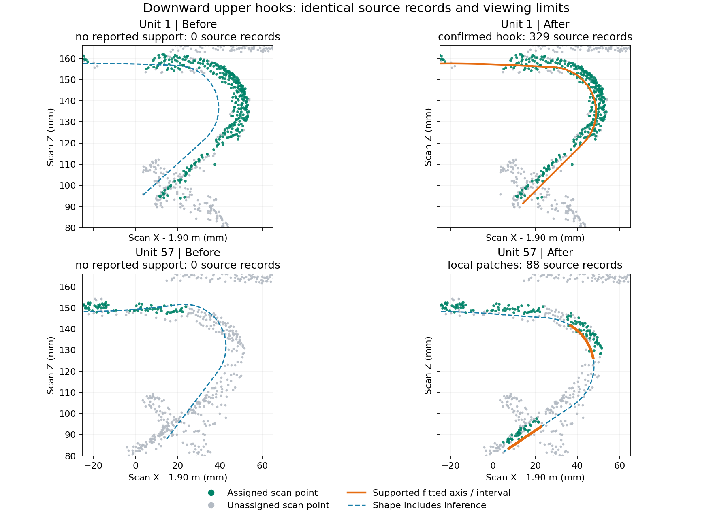

# Scan-vs-BIM 柔性配准与有符号偏差

2026-10-29 核验：柔性中心线已接入正式业务链路，算法标识为 `c2m-rebar-instance-v4`。证据来自当前 `dev-hong` 源码、本机受管理 Docker 服务、业务数据库与实际距离文件。首次核验为只读；随后针对上层向下弯钩完成 v26 修复并重算扫描 14 / BIM 13，见末节。本次没有核验或修改其他主机的线上部署。

## 原理与“内外”定义

全局配准先把扫描与设计放入共同坐标系。随后按 IFC 构件和匹配单元，以实测表面点求解钢筋中心线的平移、倾斜和弯曲。长筋采用固定设计半径的鲁棒管面拟合、样条和曲率约束，并检查局部点支撑与邻筋归属；短筋、腹杆及弯钩采用各自的受限模型。当前 BIM 引导分类还处理夹具位姿和部分预埋件端部范围，详见 [分类流程](bim-guided-classification.md)。

正式 v4 的有符号表面偏差分两步求解：

1. 用实测控制中心线计算扫描点的局部径向，并将设计外向径向投影到实测局部横截面，选择同一实例、同一侧且在搜索距离内的真实扫描点。中心线用于建立对应；缺少可信控制几何或合格点对时返回 NaN。
2. 对设计顶点 `p`、匹配的真实扫描点 `q`、设计单位外向径向 `r_design`，计算 `d = dot(q - p, r_design)`。单位米，`d > 0` 表示向外，`d < 0` 表示向内。原始设计网格与全局配准保持为计算参照。

例如一根钢筋整体向某侧移 6 mm，该侧可出现 +6 mm，背侧可出现 −6 mm。这个符号描述相对设计表面的局部位移，不能把整根钢筋简单判成一个“内”或“外”。柔性拟合的管面残差与这里的设计偏差是不同量；不能把拟合残差当作施工偏差，否则会隐去已拟合出的位移。固定设计半径的拟合也不能证明实测直径没有变化。

## 正式调用链与坐标

- `packages/alignment/src/AlignmentPage.vue::runC2M` 默认开启同侧约束，传入第二步的明确去噪版本，使用双向搜索和 `unknown` 回退。
- `services/mesh-service/algorithms/rebar_control_net.py` 调用 `rebar_prior_axis.fit_prior_axis`；当前 BIM 引导流程还会细化柔性扫掠轴。最终拟合中心线保存在控制网实例的 `centerlineM` 中。
- `services/mesh-service/pointcloud_denoise.py` 将控制网报告写入 `instance-map.json.controlNet`，坐标系明确为原始扫描坐标。
- Go 后端 `/alignments/bim/c2m` 将指定版本的 `cleaned.las`、实例映射、保留 IFC 标识的分析网格和完整列主序配准矩阵交给 `/c2m/compute`。
- `rebar_comparison.compute_instance_comparison` 检测控制网信封后选择 v4；开启同侧约束时调用 `build_control_units` 和 `ControlNetObservedSurface`，计算偏差、覆盖与检查指标。
- Go 校验算法版本、实例映射哈希、顶点范围、有效参数和检查报告来源，保存距离、着色网格及逐筋报告快照。

保存的矩阵是 Scan → GLB 原始坐标，单位米、列主序。控制中心线和扫描点均用同一个矩阵各变换一次；设计分析网格已经处于模型坐标系。不能把矩阵解释为 Scan → IFC，也不能叠加视口的 Y-up 显示旋转。完整约定见 [配准坐标](alignment-coordinate-frames.md)。

关闭同侧约束会选择有符号最近点计算；此时虽然仍有控制网检查信息，表面匹配方法已不同。应查看结果中的 `effective.normalConstraintEnabled` 和 `measurement.method`，不能仅凭 v4 版本名称判断匹配模式。

## 当前运行证据

2026-10-29 10:26（Asia/Shanghai）的只读核验：

| 扫描 / BIM | 正式报告更新时间 | 有效偏差顶点 | 向外 / 向内 | 缺测顶点 |
| --- | --- | ---: | ---: | ---: |
| 14 / 13 | 2026-10-29 10:21 | 313,295 | 150,578 / 162,717 | 92,581 |
| 5 / 7 | 2026-10-09 14:14 | 300,177 | 134,532 / 165,645 | 102,635 |

两组均保存为 `c2m-rebar-instance-v4`，同侧约束开启，方法为 `control-net-real-point-radial-correspondence-v1`，所引用去噪版本与当时数据库中的当前版本一致。14 / 13 的控制网实例中，46 个拟合单元标记为 `ifc-flexible-sweep-axis`；“单元”不等于完整物理钢筋，也不表示所有表面均已观测。

检查实际 `<f4` 距离文件：长度与网格顶点数一致，有限值及 NaN 数量与报告一致，无 Inf；实例映射文件 SHA-256 与保存清单一致。运行容器中的 `rebar_comparison.py`、`rebar_control_comparison.py`、`rebar_prior_axis.py`、`algorithms/rebar_control_net.py` 与本地源码哈希一致。

复核脚本及完整版本、哈希、计数在本机忽略目录 `.cloudbim/assessment-20261029-flexible-c2m/audit.py` 和 `audit.json`。脚本将数据库连接设为只读，仅读取现有产物，并在内存中运行确定性符号探针。

## 本次验证

- 66 项 Python 定向测试通过：`test_rebar_control_comparison.py`、`test_rebar_comparison.py`、`test_rebar_scan_surface.py`、`test_rebar_prior_axis.py`、`test_c2m_reference_core.py`。
- 后端定向检查通过：`go test ./... -run 'Test.*(RebarComparison|C2M|RebarInspection|ControlNet)' -count=1`。
- 六组符号探针通过：位移 +6、−4、+30 mm，分别在原坐标与旋转加非对称平移后验证两侧的预期正负值。30 mm 大于探针钢筋的 20 mm 直径，验证此情况下仍保留同侧方向。
- 本机前端、Go API 和 mesh-service 健康检查通过。此次未做浏览器操作回归或独立现场精度验收。

因此本次无需增加第二条接入路径；修正了练武场文档中过时的正式流程描述。早期逐簇独立实验仍可用于诊断，其参数和历史结果继续保持独立。

## 上层向下弯钩修复（2026-10-29，v26）

实际源点复现了两处问题：

1. 部分可见弯钩进入独立姿态验证前要求 96 个弯段点，比完整弯段的 48 点还多；通过验证后的短连续表面又被每段 48 点门槛丢弃。57 号弯钩有 83 个候选弯段点，原流程因此只留下设计推断。现在用 48 点进入独立验证，短局部表面按两个各至少 12 点的可靠条带检查，并要求至少三倍钢筋半径的连续跨度。双姿态一致性、法向分布、管面距离、有限侧面和唯一归属要求保持原值。
2. 主体柔性恢复后会再次拟合弯钩，原代码只计算本次新增点，导致前一遍已归属同根钢筋的真实证据被遗漏。例如 1 号弯钩虽有可用管面点，却在复核后退回待定。现在重新核实同根已有点的管面支持，仅让未归属点参与竞争；有证据的完整弯钩和局部区间均可在重复执行后保留。

`curvedPieces.pointCount` 和 `localSupport.pointCount` 在 v26 表示当前支持数，另用 `addedPointCount`、`retainedPointCount` 区分新归属与原有证据。`curveSummary.matchedPoints` 为各曲段支持数之和，不能解释为新增点数或全场景去重计数；实例总点数仍从最终逐点归属重新统计。局部区间在竞争后按实际保留点重建，完整形状仍可为 `pending`，缺测或证据不足区间不转成实测表面。

通过正式 `/alignments/bim/denoise` → `/alignments/bim/c2m` 重算，保留原配准矩阵和全部 C2M 参数，仅替换去噪版本：

| 指标 | 修复前 | v26 |
| --- | ---: | ---: |
| 1 号起端弯钩 | 待定，报告无支持 | 已确认，329 个支持点 |
| 57 号起端弯钩局部支持 | 0 | 88 点，两个连续区间 |
| 有局部证据的曲段数 | 4 | 9 |
| 全场景钢筋点 | 935,134 | 935,377 |
| C2M 有效偏差顶点 | 313,295 | 314,734 |
| C2M 缺测顶点 | 92,581 | 91,142 |

57 号的两个区间长约 19.68 / 18.67 mm，已进入最终 `inspection.observedSegments`。固定诊断框内原有 64 条记录，正式重算后 40 条新增归属；框内还包含未通过管面证据的记录，该比例不作为召回率。3 号弯钩缺少连续弧段证据，仍未宣称恢复。整体增加 243 个钢筋点，其中 223 个来自待定、20 个来自局部离群；原有钢筋点移除数、改派数均为零，夹具、预埋件等类别及场景实例数组完全相同。

图中绿色是实际归属点，灰色是未归属点；橙色是确认的拟合轴或局部支持区间，蓝色虚线表示仍含推断的形状。曲线为中心线，不应与表面点重合。

业务去噪版本为 `339c982a4a8fcc43a83fbb8d`，控制网版本为 `design-control-net-v26`；C2M 版本为 `aca6eeead7fbc3efc0b9c35855a3995f92727143d1eb5611a7b67635a68709ad`。源数据是上传后去台面的 4,038,141 条记录，逐点标签按该源文件顺序；原上传文件有 6,920,846 条记录。两者均保持不变。

验证包括 98 项 Python 测试、43 项前端数据/几何测试，以及新报告在实际页面曲段校验器和 Three.js 几何构造器中的检查。短连续表面、重复全钩复核两项新增回归先在修复前失败，修复后通过；另验证带缺测间隙的重复局部复核。正式输出逐字段保留源 LAS 属性、原始 `source_index`、坐标、法向和记录顺序；新实例索引、来源哈希、距离文件长度与有效数量一致，实际 HTTP 距离及着色 PLY 哈希正确，最新结果 `fresh=true`。原去噪目录、旧 C2M 文件及四个历史报告版本均保留。本次无可连接的浏览器，未实测 WebGL 交互，也没有人工逐点真值。

[完整核验指标](assets/terminal-hooks-2026-10-29/verification.json)。复现、冻结主体复核、正式调用和逐字段核验脚本位于本机 `.cloudbim/assessment-20261029-terminal-hooks/`；`baseline/` 保存本次修改前的算法文件，`business-before/` 保存旧报告和产物快照。冻结主体的单独曲段复核新增 114 点；正式完整流程新增 243 点，两者执行阶段不同，不混用计数。
