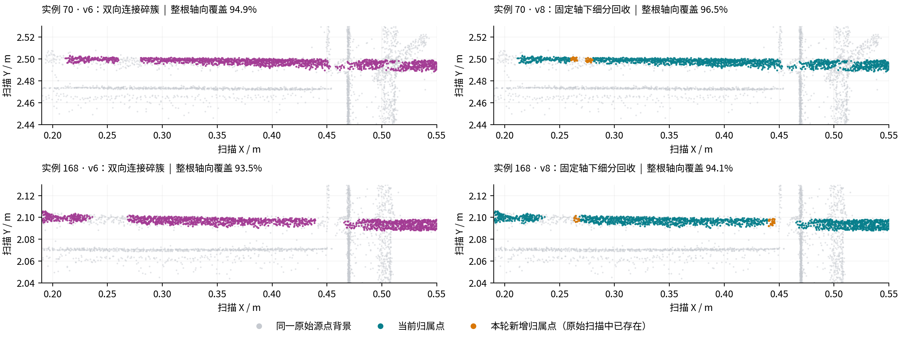

# 碎簇局部细分与固定轴后置回收

2026-10-29，`dev-hong`，本地 BIM 13 / 点云 14。正式版本 `f3cbef67a48de3add257a597`，算法 `bim-flexible-axis-v8`。比较基线为上一轮双向碎簇连接 v6：`6af026a1a7dc9300ac351728`。

## 两个需要同时处理的问题

原来的 12 mm 验证站配合 16 mm 宽窗口，会把某些 7 mm 小簇分别截成不足 6 mm 的两部分。小簇本身满足独立连接所需的跨度，但两个窗口各自都不满足，因此仍会被遗漏。回归案例将主体放在 0.30–0.70 m，在两侧加入跨窗口边界的 7 mm 簇；旧版回收率为 0，新版两侧均超过 95%。中间空缺和短簇真实边界外不成为观测区间。

此外，在一根钢筋拟合完后立即提交这些新点，会改变后续钢筋的候选源行，进而改变后面的轴线。这在正式输入上确实发生过：中间验证版 v7 的实例 62、155 丢失了部分原有支持。最终实现把细分回收后置，确保它只补充已确定模型上的观测；中间结果和诊断保留在 `early-refinement/` 及独立结果目录中。

## 最终流程

1. 按原顺序完成全部主体的 v6 柔性轴线拟合、12 mm 观测验证和源点归属。保留现有并行拟合与有界预计算。
2. 保存每根主体的小型轴线模型和窄管壁邻域源行编号。全部主体确定后，按当前归属重新过滤这些行，已有其他实例的点不参与回收。
3. 仅在仍有未覆盖管壁源点的窗口内增加交错的 6 mm 检查。复用既有截面的验证证据，重新验证尚未接受的候选窗口。新连接仍需满足原有半径、残差、法向、径向/法向变化、局部与空间留出支持条件；弱片段仍须有双侧可靠锚点。
4. 新增观测区间截到实际支持点的轴向范围，保留全部旧观测区间。新增点只来自尚未归属的原始源行；轴线、半径、坐标和原有主体归属均不因这一步改变。弯钩与端面在主体支持确定后统一处理。

代码位于 `services/mesh-service/algorithms/bim_bent_bars.py` 的 `_grow_axis_support`、`_refine_fixed_axis_support` 和 `recover_bent_bars`。结果中的 `axialGrowth` 记录粗/细步长、局部细分数、源点范围、`commitPhase=after-all-body-fits` 及新增源行数。截面计数跨两种网格，不能直接换算成物理长度；长度仍由观测区间计算。

## 正式入口结果

以下结果均来自 `/alignments/bim/denoise` 保存的版本，输入为同一份 **4,038,141** 条扫描记录。

| 指标 | v6 | v8 |
| --- | ---: | ---: |
| 钢筋分类点 | 885,699 | 886,617 |
| 轴向观测区间总数 | 174 | 170 |
| 实例 70 归属点 | 14,129 | 14,191 |
| 实例 70 整根轴向覆盖 | 94.86% | 96.52% |
| 实例 168 归属点 | 14,813 | 14,843 |
| 实例 168 整根轴向覆盖 | 93.46% | 94.08% |

逐行比较：新增 **918** 个钢筋点，释放 **0** 点，净增加 **918** 点；已归属钢筋之间的实例转移为 **0**。全部 **46** 个柔性主体的轴线系数、基函数、坐标基、半径和拟合轴采样与 v6 完全一致，旧观测区间全部保留。最终局部细分验证了 794 个额外窗口，增加 97 个观测截面。

两列采用同一源点裁剪、坐标和比例。灰色为固定三分之一源行抽样，彩色为各版本在裁剪内的全部归属点，橙色为本轮新增归属的原始扫描点。图中放大的是 X=0.19–0.55 m 的局部，标题覆盖率统计整根实例。空白处没有插值造点；剩余缺口也不能用于推断现场缺筋。

## 时间和内存

| 同条件测量 | v6 | v8 |
| --- | ---: | ---: |
| 相同模型缓存状态的计算 HTTP 请求 | 48.37 s | 49.39 s |
| 其中柔性主体阶段 | 20.52 s | 21.05 s |
| 固定输入、完整分类函数回放 | 45.17 s | 45.63 s |
| 回放轴向支持验证合计 | 0.328 s | 0.658 s |
| 回放主进程峰值 RSS | 1,048,908 KiB | 1,054,716 KiB |

计算 HTTP 配对增加 **1.02 s（2.11%）**。两边 design、alignment、scene 模型缓存均命中，源点分类和导出完整重做。这是同机配对观测，不是多轮统计结论；它不包括 Go 业务入口准备和浏览器绘制。两个计算版本与对应正式版本的全部源行类别、钢筋实例和场景实例均逐行一致。

主进程峰值约增加 5.7 MiB，不代表所有工作进程的合计峰值。仍使用现有 8 进程拟合池，没有新增全场空间树或整幅扫描副本。已确认连续主体复用连接检查，仅新窗口和新缺口执行额外验证，避免把 6 mm 身份检查重复铺满整根主体。

服务重建后缓存未命中的隔离计算为 59.54 s，不将其与热缓存基线比较。最终正式业务 HTTP 请求为 50.42 s；文件保存核验另计。开发函数回放使用历史场景缓存，最终有 887,333 个钢筋点、比其 v6 基线增加 975 个点；这些数字不代替上面的正式入口结果。

## 验证和保存

- **103 项 Python 测试通过**。本轮新增 5 项，分别覆盖短簇跨窗口边界及范围裁剪、已覆盖窗口不细分、细网格身份阻断、既有主体检查复用、后置回收对后续主体输入/旧归属/轴线参数的保护。既有双向链、平面/平行候选、弱证据、任意旋转、排除掩码、已有归属和并行一致性测试保持通过。
- 从正式保存参数重建 **46 个柔性主体及其依赖几何、872,924 个归属点**，不满足最终模型支持的点为 **0**，观测主体内部距最终管表面超过 10 mm 的点为 **0**。
- 导出的 **886,617 条 LAS 记录**的全部原始维度与对应输入子集完全一致；500,000 点预览的类别、实例和 float32 坐标逐行一致。
- 原扫描、预处理源和历史结果共 **119 个文件**的 SHA256 未变；保存配准未变。正式 latest 指向上述 v8 版本，`fresh=true`。
- 通过 `scripts/cloudbim-dev.sh start` 更新本地服务；容器算法哈希与工作区一致，实际工作进程配置为 8，前端与 API 健康检查均为 200。

这些检查证明本数据上的覆盖改善、模型/归属一致性和源点保存，不是现场逐点分类准确率。未执行页面内 WebGL 人工验收。

汇总证据见 [verification.json](../development/assets/adaptive-fragments-2026-10-29/verification.json)。修改前源码、失败及通过的回归日志、固定输入回放、正式保存核验、源行变化和逐点审计保存在 `.cloudbim/assessment-20261029-adaptive-fragments/`；隔离 HTTP 输出在 `backend/data/assessment-20261029-adaptive-fragments/`，不更新业务 latest。
