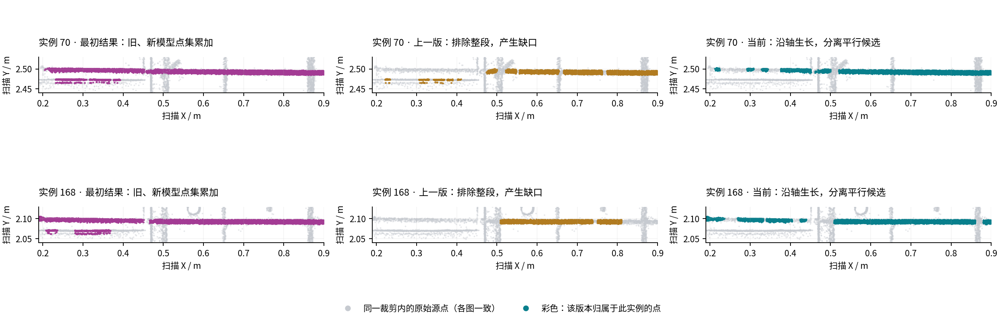

# 钢筋轴向追踪与生长：替代整截面排除

2026-10-29，`dev-hong`，本地 BIM 13 / 点云 14。

## 问题与修正

上一版 v4 把“同一个截面有多个圆管候选”直接解释为“这个截面的所有点都不能归属”。它没有利用相邻轴段已建立的连续性，导致平行干扰旁的真实钢筋也被整段排除。这一规则已撤销，包括后续弯钩/端面中的同类区间屏蔽。

当前 v5 采用两个连续的几何步骤：

1. **截面候选分簇，沿轴向追踪。** 候选圆仍需满足半径、源表面、法向和留出验证。依据已有轨迹的局部切向预测做一对一关联，分离的候选另成轨迹。可靠长段确定主体，再向两端生长；遮挡两侧必须满足双向切向连续性。每个轴向位置最多选择一个主体分支，按轴向支持和有界设计先验选择，点数多不能直接压过连续主体。
2. **拟合轴线后，直接验证源点并生长。** 单独的圆拟合失败不再等于钢筋中断。固定名义半径和已拟合轴线，从可靠截面逐站检查原始点的距离、法向一致性、径向及法向离散程度、局部支持比例和留出支持。满足条件的相邻截面获得观测支持。纯平面、无扫描点的间隙和相邻构件身份边界会停止生长。

保留上一轮正确的约束：新主体模型与完整归属点集一起替换旧版本；旧轴线的点不能继续累加。弯钩和端面在最终主体之后拟合。其他实例的所有权、排除掩码、固定半径和原有表面距离容差保持约束作用。未被选中的候选不会仅因分支竞争就被全局标记为噪声。

实现位于 `services/mesh-service/algorithms/bim_bent_bars.py` 的 `_axial_tracks`、`_grow_axis_support` 和 `_fit_ifc_axis`。证据分别保存于 `traceEvidence.tracks`、`flexibleRegistration.axialGrowth` 和 `observedSupportIntervalsM`。生长使用扫描坐标中的完整轴向局部坐标系。

## 可复现的有效点保留测试

改动前先重现失败：旋转坐标的局部竞争区间，真实钢筋点保留率为 0%；模拟局部截面检测失效时，该段保留率同样为 0%。

| 合成源点场景 | v4 主体点保留率 | v5 主体点保留率 | v5 混入的干扰点 |
| --- | ---: | ---: | ---: |
| 任意旋转后，局部平行候选 | 70.28% | 99.77% | 0 / 4,672 |
| 弯曲主体，干扰更密且更靠近设计轴 | 52.91% | 99.77% | 0 / 21,984 |
| 两条完整平行轨迹，旧归属在更密的错误轨迹 | 0% | 99.77% | 0 / 32,000 |

每个场景真实主体均为 16,000 个已知源点。局部竞争区间本身的保留率从 0% 恢复到 99.55%。这些是有真值的合成测试数据，不是现场识别准确率。

134 项回归全部通过，包括局部检测失败后的轴向恢复、平面停止生长、相邻身份约束、弯曲与遮挡、旋转坐标、已有归属、串并行一致性、弯钩/端面和导出。平面边界测试允许原有 16 mm 检测窗内的混合边界效应，要求纯平面区不被继续生长；不把这个测试解释为任意接触边界上的逐点零误差。

## 正式数据重算

通过本地 `/alignments/bim/denoise` 重算；当前结果为 `0ce5046a9503c294e45eab3f`，算法含 `bim-flexible-axis-v5`，latest 的 `fresh=true`。API 请求及保存核验约 63.1 秒。

| 指标 | 上一版 v4 | 当前 v5 |
| --- | ---: | ---: |
| 输入源记录 | 4,038,141 | 4,038,141 |
| 钢筋分类点 | 769,738 | 876,936 |
| 待判定点 | 1,443,897 | 1,337,932 |
| 有部分观测支持的物理钢筋 | 76 | 76 |
| 实例 70 的轴向观测覆盖 | 73.25% | 87.38% |
| 实例 168 的轴向观测覆盖 | 57.48% | 86.21% |

钢筋分类点净增加 **107,198**。其中 112,954 个原待判定点重新获得钢筋归属，同时 7,525 个旧钢筋点在当前模型下不再获得该类归属；其余差额来自噪声及场景候选间的标签变化。共 216 个截面经最终轴线生长获得新的观测支持。物理钢筋数量统计仍是部分匹配计数，不是完整重建率。

各列采用相同扫描坐标、裁剪和比例。灰色是同一源点背景的固定三分之一抽样，彩色是各版本归属于该实例的全部裁剪内源点。当前两例沿连续主体选择分支，未把旁边的平行点带并入同一主体。尚未得到充分距离/法向/形状支持的点仍保留在原始数据中；图中的缺口不能作为现场缺筋判断。

对正式结果的 **46 个柔性主体及其依赖曲线/端面，863,243 个归属点**，独立重建保存的 B-spline、固定半径、观测区间和依赖几何后逐点核验：不满足最终模型支持条件的点为 **0**；已观测主体内部距最终管表面超过 10 mm 的归属点为 **0**。每个实例的点数与源行归属计数一致。这里验证的是几何与归属的一致性，没有现场逐点人工真值，不能据此给出全场精度或召回率。

## 数据和交付核验

- 876,936 条 `cleaned.las` 记录的全部原始维度与输入子集逐项一致；未移动或生成源点。
- 500,000 点预览的标签、实例编号及 float32 坐标与对应源行逐项一致。
- 原扫描、预处理输入和历史去噪文件共 98 个哈希未变；保存的全局配准未变。v4 结果保留。
- 本地服务通过 `scripts/cloudbim-dev.sh start` 重建；5 个相关算法模块在容器中与工作区哈希一致；前端和 API 健康检查均为 200。
- Chrome DevTools 因现有配置目录占用无法连接，未做页面内 WebGL 验收。上图来自正式结果文件与原始扫描坐标。

完整机器证据见 [verification.json](../development/assets/axial-growth-2026-10-29/verification.json)。隔离回放、旧实现备份、合成测量、正式 API/导出审计脚本和日志保存在 `.cloudbim/assessment-20261029-axial-growth/`。`tracking-v1`/`growth-v2` 是使用历史场景缓存的开发回放，数值与正式路径略有不同；上表和图片一律取正式版本。
