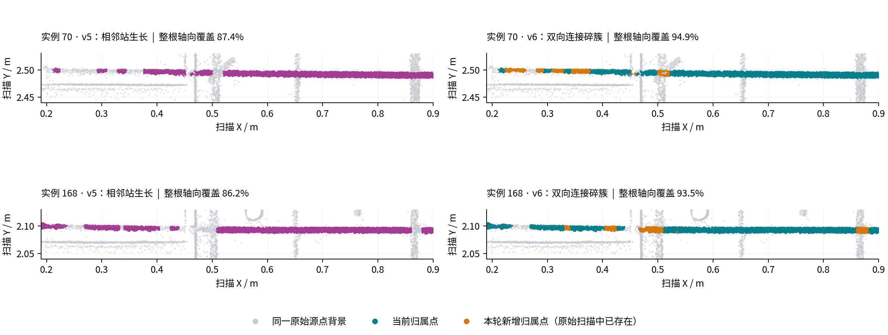

# 柔性配准后的双向碎簇连接

2026-10-29，`dev-hong`，本地 BIM 13 / 点云 14。正式结果为 `6af026a1a7dc9300ac351728`，算法包含 `bim-flexible-axis-v6`。

## 实现与边界

v5 的固定轴线生长只访问紧邻的验证站：一个站失败，后面独立验证通过的小簇仍可能无法连接。局部单侧扫描的法向变化较小，交叉位置的其他表面又会降低局部支持比例，这两种情况也会把已有主体切碎。新回归先在 v5 上复现了两侧碎簇回收率为 0 的断链。

v6 保留现有柔性轴线，以已有可靠截面为锚点：

1. 独立通过验证的小簇可以沿轴线向两个方向连接，站中心间隔最多 90 mm。独立连接需要至少 6 mm 的实际轴向源点跨度；孤立薄环不能启动连接。连接路径上的每个站仍检查夹具和相邻构件身份边界。
2. 较弱的单侧扫描或交叉杂点区域，只能在两侧可靠截面之间恢复。保留距离和法向逐点门限，另外要求径向形状、法向变化及两者相关性；相关性在训练和留出空间带内分别验证。没有另一侧可靠锚点时，不沿弱证据向外延伸。具体门限见[开发契约](../development/bim-guided-classification.md)。
3. 连接边和观测区间分别保存。只有获得源点验证的窗口进入 `observedSupportIntervalsM`；跨过空缺不等于填充空缺。所有回收点均来自原始扫描，坐标、属性、固定半径和已拟合轴线不因这一步改变。

代码位于 `services/mesh-service/algorithms/bim_bent_bars.py` 的 `_grow_axis_support` 和 `_radial_normal_correlation`。结果的 `flexibleRegistration.axialGrowth` 保存连接、恢复截面数和每站证据。全流程仍按设计顺序提交归属，后续实例和弯钩根据当前可用源点重新验证，因此完整复算不是旧标签的简单并集。

## 正式入口结果

以下数字全部来自 `/alignments/bim/denoise` 保存的正式版本，不混入开发回放。输入源记录均为 **4,038,141**。

| 指标 | v5：`0ce5046a9503c294e45eab3f` | v6：`6af026a1a7dc9300ac351728` |
| --- | ---: | ---: |
| 钢筋分类点 | 876,936 | 885,699 |
| 轴向观测区间总数 | 302 | 174 |
| 实例 70 的归属点 | 13,640 | 14,129 |
| 实例 70 的轴向覆盖 | 87.38% | 94.86% |
| 实例 70 的观测区间 | 8 | 4 |
| 实例 168 的归属点 | 14,123 | 14,813 |
| 实例 168 的轴向覆盖 | 86.21% | 93.46% |
| 实例 168 的观测区间 | 9 | 4 |

净增加 **8,763** 个钢筋点，观测区间减少 **42.4%**。逐行变化为新增 8,911 点、原钢筋标签释放 148 点，没有点从一个已归属钢筋实例改到另一个钢筋实例。新增点原先分别为待判定 8,679 点、后置场景表面候选 88 点、噪声 144 点；释放点变为待判定 117 点、噪声 31 点。原始记录始终保留。

正式结果有 5 个独立验证截面经跨缺口连接获得归属，215 个截面经双侧片段验证恢复。仍为 76 根物理钢筋有部分扫描支持；这个数量不是完整重建率。

两列使用相同扫描坐标、裁剪和比例。灰色背景为同一裁剪源行的固定三分之一抽样；彩色点为该版本归属的全部裁剪内源点。橙色表示本轮新增归属的原始点，未插值或生成点。标题中的覆盖率统计整根实例，不只统计图中裁剪。下面平行点带没有被合并到上面的实例。剩余缺口不用于推断现场缺筋。

## 耗时和资源

碎簇处理复用当前轴线投影和候选点，仅对管壁附近的源点排序，一次批量查找所有截面窗口，并缓存每站身份检查。没有新建全场空间树、复制整幅点云、创建额外进程池或重新拟合每个小簇。继续使用现有 8 进程及下一根钢筋的有界截面预计算。

| 同条件测量 | v5 | v6 |
| --- | ---: | ---: |
| 固定输入、完整分类函数回放 | 45.59 s | 45.17 s |
| 其中轴向支持/碎簇处理合计 | 0.346 s | 0.328 s |
| 回放主进程峰值 RSS | 1,049,384 KiB | 1,048,908 KiB |
| 相同模型缓存状态的计算 HTTP 请求 | 48.52 s | 48.77 s |
| 其中柔性长筋阶段 | 20.48 s | 20.62 s |

HTTP 对照增加约 **0.25 s（0.51%）**，未观察到明显耗时增长。这是同机配对测量，不是多轮统计加速结论。主进程 RSS 不代表全部工作进程的总峰值内存。

HTTP 对照通过 `:18001/pointcloud-denoise/compute`，两边均为 design/scene 缓存命中、alignment 未命中，扫描拟合和分类全部重做。它包含算法、导出和计算接口往返，不包括 Go 业务入口准备、保存及浏览器绘制。两个 HTTP 输出分别与对应正式版本的全部源行类别、钢筋实例、场景实例完全一致。

服务重建后的第一次正式业务请求为 **63.45 s**，其中构建为 **59.03 s**，设计/场景缓存均未命中；不把这次冷启动与上述热缓存 48.52 s 直接比较。固定输入开发回放使用历史场景缓存，分类点数与正式入口略有差别，不能用其 9,789 点净增代替正式结果的 8,763 点净增。

## 验证和保存

- **98 项相关 Python 测试通过**：29 项核心测试、69 项并行/场景/曲线/端面/去噪导出测试。新增覆盖双向碎簇链、缺口不填充、过远片段、身份阻断、孤立薄环、单侧弱证据、带噪平面，以及任意旋转坐标、源行顺序、法向符号、排除掩码和已有归属。
- 对正式结果的 **46 个柔性主体及其依赖几何、872,006 个归属点**，从保存参数重建最终模型后逐点检查，不满足最终模型支持条件的点为 **0**；观测主体内部距最终管表面超过 10 mm 的点为 **0**。实例计数与源行归属计数一致。
- **885,699 条导出 LAS 记录的全部原始维度**与对应输入子集逐项一致。500,000 点预览的类别、实例和 float32 坐标逐行一致。
- 原扫描、预处理输入、历史结果共 **105 个文件**的 SHA256 未变；保存配准未变。v5 结果仍在原版本目录。当前 latest 为 v6，`fresh=true`。
- 本地服务通过 `scripts/cloudbim-dev.sh start` 更新，容器算法哈希与工作区一致，实际工作进程配置为 8；前端和 API 健康检查均为 200。

这些结果证明源点保存、几何/归属一致性和本数据上的覆盖改善，不是现场逐点分类准确率。未执行页面内 WebGL 人工验收；图来自正式输出与原始扫描坐标。

完整汇总见 [verification.json](../development/assets/fragment-link-2026-10-29/verification.json)。复现脚本、修改前源码快照、失败/通过的测试日志、固定输入回放、HTTP 对照、原文件哈希、源行变化和逐点审计保存在 `.cloudbim/assessment-20261029-fragment-link/`。隔离 HTTP 输出位于 `backend/data/assessment-20261029-fragment-link/`；这些对照不更新业务 latest。
