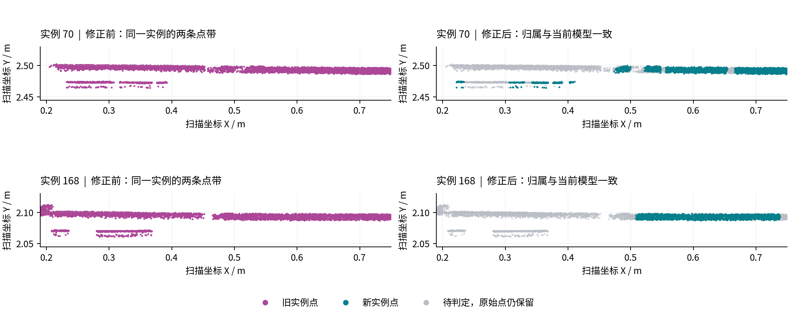

# 同一钢筋实例包含平行点带：机制诊断与修正

2026-10-29，本地 `dev-hong`，BIM 13 / 点云 14。

> 历史记录：本文对应 v4。其中“多候选截面整体排除”的规则会误删连续钢筋的有效点，已由 [v5 轴向追踪与生长](pointcloud-axial-growth-2026-10-29.md) 取代。下文保留当时的实现和测量结果；不再作为当前算法的接受标准。

## 已确认的原因

逐点实例编号确认，实例 70、168 中存在两条分离点带，并非显示颜色碰巧相同。两批输入点本身已经存在；分类导出没有生成或移动点。是否包含多站拼接重影、邻近物体或其他采集问题，仍需分站原始证据，当前不能确定。

旧流程先拟合主体、弯钩和端面，再重新拟合柔性主体。新的轴线替换了模型，但点归属只增加，不撤销旧模型分配的点。实际效果是 `旧点集 ∪ 新点集` 对应一条新轴线。弯钩的第二遍拟合同样保留旧归属。模型与观测点集因此不再属于同一次几何解。

另一个问题是局部截面可以找到两组均通过圆管、半径、法向量和留出验证的候选。原追踪只选高分路径，未表达“同一个设计身份存在多个物理解释”。仅撤销旧点集仍可能任意选取其中一组。

合成回归先在旧实现上失败：相距约 35 mm 的两条管表面被分到同一实例，新模型接收 15,963 点，同时保留 2,000 个旧点。另有“模型已有全部点但轴线已变”的回归，发现旧代码会因新增点为零而跳过模型更新。

## 机制变更

1. **模型与点集一起更新。** 通过验证的新主体取代旧主体的归属点集，未获支持的旧点回到 pending。即使没有新增点，也提交新模型及其完整支持集合。其他钢筋的归属不被覆盖。失败的拟合保留上一模型及其非歧义支持。
2. **保留并识别截面多解。** 两个已通过原有验证的候选，若中心距离大于二者半径之和加两倍表面容差，就属于分离的管表面解释。对应轴向采样单元不授权实例归属。没有改变原有圆管距离、法向量或半径接受阈值，也没有按本例坐标或实例编号加规则。
3. **先定主体，再计算依赖部分。** BIM 引导流程的控制网先输出主体；柔性修正完成后统一拟合弯段、弯钩和端面。歧义区间及其完整扫描坐标系沿流程传递，后续拟合不能重新收回这些点。
4. **并行预取遵守相同语义。** 下一钢筋的候选预取包含当前主体可能释放的点，提交前再按最新归属筛选。回归验证单进程与并行结果一致。

这里约束的是一个主体匹配单元在同一轴向位置的截面解释。合法 U 形钢筋的多个设计分段仍由设计拓扑和曲线证据描述；不能把“物理钢筋有回折”与“旧、新主体点集混用”混为一谈。无法确定归属时保留原始点，不把它们直接定义为噪声。

## 实际数据验证

基线版本为 `986434c34d2d2a6f76877076`。新版本为 `4fe488478654909ce3c8da86`，算法包含 `bim-flexible-axis-v4`。通过本地 `/alignments/bim/denoise` 生成，用时约 58 秒（算法）/62 秒（请求及保存检查），latest 返回 `fresh=true`。

| 检查项 | 基线 | 新版 |
| --- | ---: | ---: |
| 输入记录数 | 4,038,141 | 4,038,141 |
| 钢筋分类点 | 935,379 | 769,738 |
| 待判定点 | 1,279,742 | 1,443,897 |
| 获得部分观测支持的物理钢筋 | 76 | 76 |
| 实例 70 的指定异常旧点仍归属于该实例 | 559 | 0 |
| 实例 168 的指定异常旧点仍归属于该实例 | 511 | 0 |

上述 1,070 个点位于主体内部的已支持轴向区间，却距基线最终管表面约 17–32 mm；新版全部为待判定，均未改成噪声。它们不是全场人工标注，也不能用作全局错误率的分母。

对新版 44 个完成柔性拟合的主体及其依赖曲线/端面涉及的 723,497 个归属点，用保存的 B-spline 参数、固定名义半径、法向量、观测区间以及最终曲线证据重建检查：无缺乏当前模型支持的归属点；全体实例的已记录歧义区间中，归属点数为零。相同检查在基线失败，计得 70,746 个不满足其保存模型完整支持条件的点。前后模型数量和点数不同，这项检查证明模型与归属的一致性，不代表现场分类准确率。

紫色为旧归属，青色为新归属，灰色为转回待判定的原始点。图用同一源坐标、同一比例和固定裁剪绘制，没有移动点或隐藏灰色原始观测。保守归属会产生可见缺口；缺口不能解释为现场缺筋。

## 验证与保留

- 131 项不同测试通过：111 项主体/曲线/并行/导出回归，1 项旋转坐标的局部歧义回归，19 项端面及场景后续回归。
- 769,738 条导出 LAS 记录的全部源维度与输入子集逐项相同；实例编号与逐点标签一致。
- 500,000 点预览的标签、实例编号与源行抽样逐项相同，坐标与指定原点下的 float32 表示一致。
- 原始扫描、预处理源文件和历史结果共 91 个文件哈希未变；已保存的配准响应未变。
- 本地主体服务已按项目脚本重建，6 个相关算法模块的容器文件哈希与工作区一致。前端和 API 均返回 200。
- 浏览器工具无法连接当前浏览器，未完成页面内 WebGL 视觉验收。上图是直接从正式结果和原始扫描坐标生成的诊断图。

机器可读核验见 [verification.json](../development/assets/instance-ownership-2026-10-29/verification.json)。完整阶段回放、原实现备份、日志、逐点证据和脚本在 `.cloudbim/assessment-20261029-instance-ownership/`；`replay.py` 隔离回放，`check_revision.py` 验证保存模型与源行，`verify_export.py` 检查正式导出。

本次修正封住了已复现的跨模型点集累加及歧义归属路径。它没有恢复缺失扫描、证明第二条点带的采集成因，或建立独立现场真值。分类覆盖减少是明确的保守取舍，后续若要恢复这些待判定区间，需要新增能够区分候选的观测或拓扑证据。
